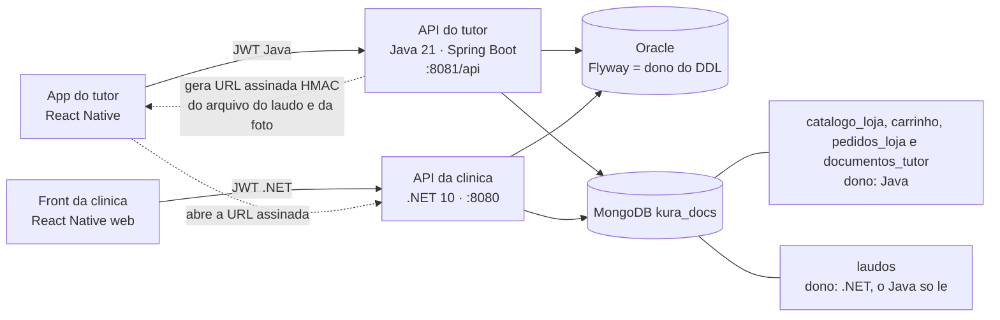
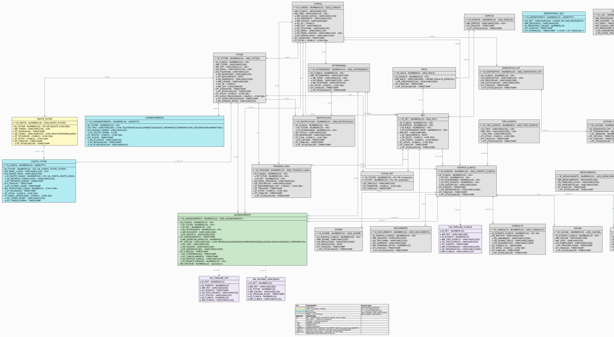

# KURA — Backend Tutor (Java / Spring Boot)

> API REST do **Portal do Tutor** da plataforma KURA — solução de continuidade do cuidado veterinário desenvolvida para o FIAP Challenge 2026 (parceiro: Clyvo Vet).


[](https://github.com/KURA-Clyvo/backend-tutor-java/actions/workflows/ci.yml)


---

## Sprint 4 em 1 minuto

**O problema.** Tutor e clínica veterinária ficam desconectados: o tutor não vê o que a clínica registrou (laudos, vacinas, agenda) e não tem onde guardar os documentos do próprio pet. O KURA liga os dois lados. Este repositório é o **backend do lado do tutor**: autentica o tutor, lê o que a clínica registrou e recebe o que o tutor envia.

**Onde ver rodando (links da aplicação).** Os endereços abaixo são os do ambiente Azure da Sprint 4, informados pela equipe em 27/10/2026. **Este README não afirma que estão no ar**: o banco da Azure (VM Oracle + MongoDB) foi desligado em 27/10 e nenhum desses endereços foi chamado na preparação desta entrega.

| Peça | Endereço |
|---|---|
| API do tutor (este repositório) | `https://kura-tutor-api-g9e3b2g6aggueuev.eastus2-01.azurewebsites.net` (saúde: `/api/actuator/health`) |
| App web do tutor (Static Web App) | `https://green-tree-070ecd90f.1.azurestaticapps.net` |

Para rodar sem a Azure, veja a [seção 3](#3-como-executar).

**Vídeo da Sprint 4:** <!-- LINK DO VÍDEO: preencher -->

**O que entrou na Sprint 4 neste backend** (cada item aponta o arquivo que o implementa):

| Entrega | Onde |
|---|---|
| Persistência poliglota: MongoDB `kura_docs` ao lado do Oracle | [`loja/`](src/main/java/br/com/clyvo/kura/tutor/loja/), [`documento/`](src/main/java/br/com/clyvo/kura/tutor/documento/), [`laudo/`](src/main/java/br/com/clyvo/kura/tutor/laudo/) |
| Loja (catálogo de produtos, pré-lançamento): `GET /v1/loja/catalogo` | [`LojaCatalogoController`](src/main/java/br/com/clyvo/kura/tutor/loja/bff/api/LojaCatalogoController.java) |
| Documentos do pet (RG, carteira de vacina, microchip): upload, lista, download, exclusão | [`DocumentoTutorController`](src/main/java/br/com/clyvo/kura/tutor/documento/bff/api/DocumentoTutorController.java) |
| Laudos do pet, somente leitura, escritos pela clínica (.NET) | [`LaudoTutorController`](src/main/java/br/com/clyvo/kura/tutor/laudo/bff/api/LaudoTutorController.java) |
| URL assinada (HMAC) para o arquivo do laudo e da foto, sem HTTP entre as APIs | [`MontadorUrlAssinada`](src/main/java/br/com/clyvo/kura/tutor/shared/foto/MontadorUrlAssinada.java), [`GeradorUrlLaudo`](src/main/java/br/com/clyvo/kura/tutor/laudo/infra/GeradorUrlLaudo.java) |
| Schema e índices do Mongo versionados no código, com runner idempotente que repara índice divergente | [`AplicadorSchemaColecao`](src/main/java/br/com/clyvo/kura/tutor/shared/mongo/AplicadorSchemaColecao.java), [`src/main/resources/mongo/`](src/main/resources/mongo/) |
| Testes contra `mongod` real embarcado (tag `mongo-real`) | [`MongodEmbarcado`](src/test/java/br/com/clyvo/kura/tutor/shared/mongo/MongodEmbarcado.java) |

**Testado contra** `mongod` 7.0 embarcado (flapdoodle 4.20.0) nos testes automatizados e contra MongoDB 7.0.45 no compose local do `DevOps-Cloud` (gate G4 desta sprint, ver [seção 7](#7-testes)). Nada aqui foi medido em ambiente de produção.

---

## Sumário

1. [Contexto e Arquitetura](#1-contexto-e-arquitetura)
2. [Stack Tecnológica](#2-stack-tecnológica)
3. [Como Executar](#3-como-executar)
4. [Variáveis de Ambiente](#4-variáveis-de-ambiente)
5. [Referência da API](#5-referência-da-api)
6. [Banco de Dados e Migrations](#6-banco-de-dados-e-migrations)
7. [Testes](#7-testes)
8. [Gestão de Configuração dos Artefatos](#8-gestão-de-configuração-dos-artefatos)
9. [Equipe e Divisão de Trabalho](#9-equipe-e-divisão-de-trabalho)
10. [Vídeo](#10-vídeo)

Atalhos: [Sprint 4 em 1 minuto](#sprint-4-em-1-minuto) (acima do sumário); dentro da seção 1: [1.5 Decisões da Sprint 4](#15-decisões-da-sprint-4-persistência-poliglota) e [1.6 Integração com as demais disciplinas](#16-integração-com-as-demais-disciplinas-evidências).

---

## 1. Contexto e Arquitetura

O KURA é um sistema com dois backends distintos: este repositório — **Java/Spring Boot** — atende o **aplicativo móvel do Tutor**, enquanto um backend **.NET 10** atende o **front-end web da Clínica**. Os dois compartilham o mesmo **schema Oracle** (dados transacionais, DDL versionado pelo Flyway deste repositório) e, desde a Sprint 4, o mesmo **MongoDB** (`kura_docs`, dados de documento). **Não há chamada HTTP entre as duas APIs**: a integração acontece pelos dois bancos.



Leitura do diagrama: (1) o Java é dono das coleções `catalogo_loja`, `carrinho`, `pedidos_loja` e `documentos_tutor`; a `laudos` é da .NET e o Java só lê. (2) O arquivo do laudo e a foto do pet **moram no storage da .NET**: o Java apenas assina a URL (HMAC, mesmo segredo nos dois lados) e o app abre essa URL direto na .NET. (3) Tabelas do Oracle seguem o ownership da seção 1.2.

### 1.1 Bounded Contexts

A estrutura de pacotes segue a organização **contexto primeiro, camada depois**. Cada bounded context é responsável por tabelas específicas do banco e expõe seus próprios controllers, services e repositories.

```
br.com.clyvo.kura.tutor/
├── auth/           Login · Refresh · Logout · infraestrutura JWT
├── onboarding/     Registro por convite (consome token emitido pelo .NET)
├── tutor/          Tutor · Pet · Espécie · Raça (leitura de dados do .NET)
├── timeline/       VW_TIMELINE_PET · VW_VACINAS_VENCENDO (views Oracle, read-only)
├── consentimento/  Rastreamento de consentimentos LGPD · Chave de idempotência
├── notificacao/    Notificações (push, e-mail) do tutor
├── agendamento/    Agendamentos (shared-write com .NET via @Version)
└── shared/         SecurityConfig · CorsConfig · GlobalExceptionHandler · CorrelationIdFilter · CacheConfig
```

Cada contexto acima segue `api/` (controllers + DTOs) → `application/` (services) → `domain/` (entidades + repositórios).

**Estrutura legada** — ainda existe no disco, não apagar sem checar quem referencia. Serve a collection Postman, testes mais antigos e um healthcheck com rotas id-scoped:

```
br.com.clyvo.kura.tutor/
├── controller/  Só sobrou AutenticacaoController.java — stub @Deprecated vazio, mantido para não quebrar import legado
├── entity/      Entidades @Immutable das tabelas .NET-owned (Tutor, Pet, Clinica, Especie, Raca, Veterinario, TutorPet) + ContaTutor (Java-owned)
├── repository/  Repositórios Spring Data para as entidades acima
├── dto/         Request/Response da era pré-bounded-context
├── service/     AuthService.java legado
├── config/      Só sobrou SwaggerConfig.java — stub @Deprecated vazio (substituído por shared/config/OpenApiConfig)
└── exception/   GerenciadorExcecoes.java é stub @Deprecated vazio, MAS RecursoNaoEncontradoException e
                 RegraDeNegocioException no mesmo pacote são aliases de compatibilidade ATIVOS — usados
                 de verdade pelos services novos (agendamento, consentimento, onboarding, tutor, bff)
```

**`bff/api/`** — o que o app mobile realmente chama, e que não tem seção própria neste índice até esta revisão:

```
br.com.clyvo.kura.tutor/
└── bff/api/
    ├── AuthBffController.java
    ├── AgendamentoBffController.java
    ├── ConsentimentoBffController.java
    ├── NotificacaoBffController.java
    └── TutorBffController.java
```

Os 5 controllers expõem `/v1/**` e são **sempre auto-escopados pelo JWT** — nunca recebem `idTutor` no path, porque o tutor logado é quem o token diz que é (evita IDOR: `{id}`/`{idPet}` no path identificam o recurso, nunca o tutor).

**Duas perguntas frequentes sobre esta estrutura:**

- *Por que existem dois `AuthController`?* `controller/AutenticacaoController` é o nome antigo, renomeado para `auth/api/AuthController` — o antigo ficou como stub `@Deprecated` vazio só para não quebrar import de código legado, não tem lógica.
- *Por que `Tutor.java` (em `entity/`) é `@Immutable`?* `TUTOR` é tabela **.NET-owned** — este backend Java lê mas não escreve nela. O `@Immutable` do Hibernate transforma esse acordo em erro de runtime em vez de depender de disciplina de código. A única tabela de escrita compartilhada é `AGENDAMENTO`, e é por isso que ela (`agendamento/domain/Agendamento.java`) tem lock otimista via `@Version`/`NR_VERSION`.

Documentação completa das decisões arquiteturais em [`docs/architecture.md`](docs/architecture.md).

### 1.2 Boundary Java ↔ .NET

| Tabela | Owner | Acesso Java |
|---|---|---|
| `CONTA_TUTOR` | **Java** | Escrita exclusiva |
| `CONSENTIMENTO` | **Java** | Insert-only (histórico LGPD) |
| `IDEMPOTENCY_KEY` | **Java** | Escrita exclusiva |
| `AGENDAMENTO` | **Compartilhada** | Java: POST / PUT / DELETE (tutor); .NET: PATCH ST_STATUS (vet) |
| `TUTOR`, `PET`, `INVITE_TUTOR`, `CLINICA`, `VETERINARIO` | **.NET** | Somente leitura (`@Immutable`) |
| `ESPECIE`, `RACA` | **.NET** | Somente leitura + cache Caffeine |
| Mongo `catalogo_loja`, `carrinho`, `pedidos_loja`, `documentos_tutor` | **Java** | Leitura e escrita (a `catalogo_loja` só é lida pela API; o seed de exemplo escreve) |
| Mongo `laudos` | **.NET** | Java **somente lê**, sempre pelo `idPet` depois de provar o vínculo no Oracle |

Concorrência em `AGENDAMENTO` gerenciada por `@Version` (`NR_VERSION`). Escrita com versão desatualizada retorna **HTTP 409 Conflict** em ambos os backends. A integração não passa por HTTP entre as APIs: as duas leem e escrevem no mesmo banco, cada uma respeitando o ownership acima.

### 1.3 Principais Decisões de Design

| Preocupação | Decisão | Justificativa |
|---|---|---|
| **Autenticação** | JWT stateless — access token 15 min + refresh 7 dias com rotação BCrypt | Minimiza janela de abuso; revogação sem estado compartilhado |
| **Onboarding** | Exclusivamente por convite (`POST /onboarding/register-invite`; alias legado `POST /auth/register-invite`, TASK-48, removido na TASK-82) | Convites são emitidos pelo .NET; Java os consome atomicamente em uma única transação |
| **Concorrência** | Optimistic locking (`@Version`) em `AGENDAMENTO` | Evita deadlocks por lock pessimista entre backends distintos |
| **Idempotência** | Tabela `IDEMPOTENCY_KEY` (sem Redis) | Segura em rollback — a chave é gravada na mesma transação que a operação protegida |
| **Cache** | Caffeine in-process apenas para `ESPECIE` / `RACA` | São catálogos estáticos; entidades mutáveis (`Tutor`, `Pet`) nunca são cacheadas |
| **Envelope de erro** | Subconjunto do RFC 7807 (`status`, `error`, `message`, `path`, `correlationId`) | Contrato consistente; cada request recebe `X-Correlation-Id` para rastreamento no servidor |
| **Gestão de schema** | Flyway, 22 migrations aplicadas em `main` (V1 a V23, não existe V20 em `main`) — ver seção 6 | Java e .NET escrevem no mesmo schema; todo DDL deve ser versionado para evitar drift |

As migrations vivem em três diretórios: [`db/migration/`](src/main/resources/db/migration/) tem SQL portável que roda nos dois perfis (`dev` e `prod`); [`db/migration-oracle/`](src/main/resources/db/migration-oracle/) e [`db/migration-h2/`](src/main/resources/db/migration-h2/) têm as versões em que a sintaxe realmente diverge entre os dois bancos (ex.: a expressão de `DEFAULT` da PK — `SEQ_X.NEXTVAL` no Oracle, `NEXT VALUE FOR SEQ_X` no H2) — hoje são V2, V3, V5, V12, V15, V17, V18, V21 e V23. Onde a sintaxe não diverge, existe um arquivo só em `db/migration/` (V16, V19 e V22 são assim).

### 1.4 Diagrama Entidade-Relacionamento (Notação Barker via PlantUML)



### 1.5 Decisões da Sprint 4 (persistência poliglota)

**Por que Oracle e MongoDB.** O dado transacional do KURA (tutor, pet, agendamento, consentimento) tem chaves estrangeiras, concorrência otimista e é compartilhado com a .NET: fica no Oracle, onde o Flyway é a autoridade de DDL. O dado de **documento** tem outra forma: o catálogo da Loja tem atributos que variam por categoria, os laudos têm campos variáveis por tipo de exame e o documento do pet carrega um arquivo junto dos metadados. Esse dado é lido por documento inteiro, sem junção, e foi para o MongoDB. O banco documental não substitui o Oracle: o Oracle continua sendo a fonte de verdade de quem é o tutor, de quais pets são dele e de quem pode ver o quê.

| Decisão | Por que | Onde está no código |
|---|---|---|
| **Coleções com dono.** `catalogo_loja`, `carrinho`, `pedidos_loja` e `documentos_tutor` são do Java; `laudos` é da .NET e o Java só lê. | Duas APIs escrevendo na mesma coleção reproduzem o problema de drift que o Flyway resolveu no Oracle. O contrato `documentos_tutor` v1 foi congelado porque a .NET passa a lê-la. A role Mongo do Java (`kura_java_runtime`) tem só `find` em `laudos`. | [`LaudoLeituraRepositorio`](src/main/java/br/com/clyvo/kura/tutor/laudo/application/LaudoLeituraRepositorio.java) (porta só de leitura), [`DocumentoTutorRepositorio`](src/main/java/br/com/clyvo/kura/tutor/documento/application/DocumentoTutorRepositorio.java) |
| **Escopo obrigatório na assinatura do repositório.** Todo método de `DocumentoTutorRepositorio` recebe `long idTutor` como 1º parâmetro; todo método de `LaudoLeituraRepositorio` recebe `long idPet`. Um teste por reflexão trava isso, inclusive em interfaces herdadas. | Esquecer o filtro de tenant foi o defeito mais caro deste projeto. Colocar o escopo na assinatura faz o teste cobrar, em vez de depender de revisão. | [`EscopoRepositorioReflexaoTest`](src/test/java/br/com/clyvo/kura/tutor/documento/application/EscopoRepositorioReflexaoTest.java), [`EscopoLeituraLaudoReflexaoTest`](src/test/java/br/com/clyvo/kura/tutor/laudo/application/EscopoLeituraLaudoReflexaoTest.java) |
| **Vínculo `TUTOR_PET` no Oracle antes de qualquer leitura no Mongo.** Sem vínculo: 403; pet inativo: 404. | O Mongo guarda `idPet`, mas quem diz que o pet é do tutor é o Oracle. Checar primeiro impede que um `idPet` alheio chegue ao Mongo. | [`GuardaPetDoTutor`](src/main/java/br/com/clyvo/kura/tutor/shared/pet/GuardaPetDoTutor.java) |
| **Arquivo no próprio documento (BinData), teto de 5 MiB, tipo validado por assinatura.** JPEG, PNG, WEBP e PDF são reconhecidos pelos primeiros bytes (magic bytes), nunca pela extensão nem pelo `Content-Type` do cliente. Limite de 20 documentos por pet. | A alternativa de gravar no storage da .NET exigiria HTTP entre as APIs, proibido pela arquitetura; GridFS só compensa acima do limite de 16 MiB do BSON. As listas não trazem os bytes. | [`AssinaturaArquivo`](src/main/java/br/com/clyvo/kura/tutor/documento/application/AssinaturaArquivo.java), [`DocumentoTutorService`](src/main/java/br/com/clyvo/kura/tutor/documento/application/DocumentoTutorService.java) (`TETO_POR_PET`) |
| **Exclusão física.** `DELETE` remove o documento do Mongo (não é soft delete) e responde 404 se o documento não for do tutor e do pet da rota, sem exigir vínculo ativo. | LGPD art. 18, VI: o titular pode pedir a eliminação do próprio dado; o filtro `{_id, idTutor, idPet}` impede tocar dado alheio. Isto difere do soft delete usado no Oracle. | [`DocumentoTutorMongoRepositorio`](src/main/java/br/com/clyvo/kura/tutor/documento/infra/DocumentoTutorMongoRepositorio.java) |
| **URL assinada em vez de HTTP entre as APIs.** O Java monta `{base}/api/v1/laudos/arquivos/{chave}?exp=&sig=` com HMAC; quem entrega o arquivo é a .NET. Sem base ou segredo configurados, `urlArquivo` vem `null` e a tela mostra só os metadados. | O arquivo do laudo está no storage da .NET. Assinar a URL dá acesso temporário sem o Java chamar a .NET. O segredo é o mesmo `FOTO_URL_SECRET` das fotos; a separação entre foto e laudo vem da rota e da regex da chave. | [`GeradorUrlLaudo`](src/main/java/br/com/clyvo/kura/tutor/laudo/infra/GeradorUrlLaudo.java), [`MontadorUrlAssinada`](src/main/java/br/com/clyvo/kura/tutor/shared/foto/MontadorUrlAssinada.java) |
| **Mongo fora do ar não derruba a API.** As rotas que dependem dele respondem 503 com código próprio (`DOCUMENTOS_INDISPONIVEL`, `LAUDOS_INDISPONIVEL`, `CATALOGO_INDISPONIVEL`); login e pets continuam. Timeout curto de seleção de servidor (2 s). O health indicator do Mongo está desligado de propósito: um banco que não é o do tutor não pode deixar o container `unhealthy`. | O tutor precisa continuar entrando e vendo os pets mesmo com o Mongo parado. Consequência declarada: `/actuator/health` fica `UP` sem o Mongo. | [`MongoExceptionHandlerBase`](src/main/java/br/com/clyvo/kura/tutor/shared/exception/MongoExceptionHandlerBase.java), [`RunnerMongoTolerante`](src/main/java/br/com/clyvo/kura/tutor/shared/mongo/RunnerMongoTolerante.java), `management.health.mongo.enabled=false` em [`application.yml`](src/main/resources/application.yml) |
| **Runner de schema idempotente que repara índice divergente (E61).** Na subida (flag ligada) aplica o `$jsonSchema` (`collMod` se a coleção existe) e os índices do arquivo; se o servidor recusa um índice por divergência (códigos 85 e 86), remove pelo nome e recria. | Sem isso, um índice com mesmo nome e chave diferente ficava para sempre divergente do contrato, e o erro era engolido. | [`AplicadorSchemaColecao`](src/main/java/br/com/clyvo/kura/tutor/shared/mongo/AplicadorSchemaColecao.java), [`documentos_tutor.indexes.json`](src/main/resources/mongo/documentos_tutor.indexes.json) |

Limites conhecidos, declarados: o teto de 20 documentos por pet não é atômico (dois uploads simultâneos no 20º podem gerar 21); e quando o Java sobe antes do Mongo num ambiente novo, o schema só é aplicado no próximo boot (no compose do `DevOps-Cloud` o Mongo sobe antes do `kura-tutor`).

### 1.6 Integração com as demais disciplinas (evidências)

Todos os links abaixo são de repositórios públicos da organização, conferidos em 29/10/2026 com `git ls-remote` e `git ls-tree` na `main` de cada um (hash entre parênteses). Onde não há evidência pública, a linha não existe.

| Disciplina | O que foi feito e como se liga a este backend | Evidência |
|---|---|---|
| **Database** | Packages PL/SQL da Sprint 4 (`PKG_KURA_LOG`, `PKG_TRIAGEM`, `PKG_COBRANCA`, `PKG_AUDITORIA`), exportação das cobranças para JSON e importação no MongoDB com `$jsonSchema` estrito e índices justificados. | [`src/2TDSPF_2026_Packages_Integrantes.sql`](https://github.com/KURA-Clyvo/Mastering-Relational-Database/blob/main/src/2TDSPF_2026_Packages_Integrantes.sql) · [`scripts/2TDSPF_2026_Exportar_Json.sql`](https://github.com/KURA-Clyvo/Mastering-Relational-Database/blob/main/scripts/2TDSPF_2026_Exportar_Json.sql) · [`mongo/README.md`](https://github.com/KURA-Clyvo/Mastering-Relational-Database/blob/main/mongo/README.md) (`63e5916`) |
| **.NET** | Dona da coleção `laudos`; grava o laudo que este backend lê, com o contrato v1 e o schema/índices em arquivo. | [`LaudosController.cs`](https://github.com/KURA-Clyvo/backend-clinica-dotnet/blob/main/src/Kura.Api/Controllers/LaudosController.cs) · [`laudos.schema.json`](https://github.com/KURA-Clyvo/backend-clinica-dotnet/blob/main/src/Kura.Infrastructure/Mongo/schema/laudos.schema.json) (`8ed7835`) |
| **Mobile** | O app do tutor consome `GET /v1/loja/catalogo` (tela e serviço da Loja). As telas de documentos e laudos do pet **não** estão na `main` do app nesta data. | [`src/services/loja.service.ts`](https://github.com/KURA-Clyvo/mobile-tutor-rn/blob/main/src/services/loja.service.ts) · [`src/app/(tabs)/loja/index.tsx`](https://github.com/KURA-Clyvo/mobile-tutor-rn/blob/main/src/app/%28tabs%29/loja/index.tsx) (`c51073b`) |
| **QA** | Plano de testes de sistema (PDF), 13 casos, e automação em Selenium IDE sobre os apps; os defeitos E66 e E67 achados pelos testes foram corrigidos antes da entrega, segundo o README do repositório. | [`README.md`](https://github.com/KURA-Clyvo/Compliance-QA-Tests/blob/main/README.md) · [`manual/2TDSPF_2026_PlanoTestes_KURA.pdf`](https://github.com/KURA-Clyvo/Compliance-QA-Tests/blob/main/manual/2TDSPF_2026_PlanoTestes_KURA.pdf) · [`automacao/KURA-QA.side`](https://github.com/KURA-Clyvo/Compliance-QA-Tests/blob/main/automacao/KURA-QA.side) (`1fa8198`) |
| **DevOps** | `deploy.sh` do App Service injeta `SPRING_DATA_MONGODB_URI`, `KURA_DOCUMENTOS_MONGO_INIT_ENABLED` e `LAUDO_URL_BASE` no `tutor-api`; o script de roles do Mongo cria o usuário `kura_java`; `smoke-contratos.sh` cobre as rotas de documentos e laudos. | [`azure/deploy.sh`](https://github.com/KURA-Clyvo/DevOps-Cloud/blob/main/azure/deploy.sh) · [`mongo/init/01-roles-usuarios.js`](https://github.com/KURA-Clyvo/DevOps-Cloud/blob/main/mongo/init/01-roles-usuarios.js) · [`scripts/smoke-contratos.sh`](https://github.com/KURA-Clyvo/DevOps-Cloud/blob/main/scripts/smoke-contratos.sh) · [`docs/ARQUITETURA.md`](https://github.com/KURA-Clyvo/DevOps-Cloud/blob/main/docs/ARQUITETURA.md) (`cdea5cc`) |
| **IA** | A Luna (triagem por WhatsApp) fala com a .NET e não chama esta API. A ligação com este repositório é o schema: as migrations V13 (`LOG_ERRO`, escrita pela Luna) e V15/V16 (`INTERACAO_CANAL`, gravada pela .NET a pedido da Luna) são versionadas aqui. | [`README.md` da Luna](https://github.com/KURA-Clyvo/kura-luna-ai/blob/main/README.md) (`d2ccbc2`) |

---

## 2. Stack Tecnológica

| Tecnologia | Versão | Uso |
|---|---|---|
| Java | 21 | Linguagem (LTS) |
| Spring Boot | 3.2.5 | Framework da aplicação |
| Spring Data JPA · Hibernate 6 | BOM | ORM / persistência |
| Spring Security | BOM | Autenticação stateless |
| jjwt | 0.12.6 | Geração e validação de JWT |
| Springdoc OpenAPI | 2.5.0 | Swagger UI |
| Caffeine | BOM | Cache in-process (espécies / raças) |
| Flyway | BOM | Versionamento de schema (22 migrations em `main`, V1 a V23 sem a V20) |
| Spring Data MongoDB | BOM | Loja, documentos do pet e laudos (database `kura_docs`) |
| MongoDB | 7.0 | Banco documental; testado em 7.0.45 no compose local do `DevOps-Cloud` |
| flapdoodle embed mongo | 4.20.0 | `mongod` 7.0 real embarcado, só nos testes (tag `mongo-real`) |
| Oracle 19c / 23c | — | Banco transacional (Oracle FIAP; no ambiente Azure da Sprint 4, Oracle XE 21c numa VM, segundo o `DevOps-Cloud`) |
| H2 | BOM | Banco em memória (perfil dev) |
| JUnit 5 · Mockito · AssertJ | BOM | Testes unitários e de integração |
| Lombok | BOM | Redução de boilerplate |
| Docker · Docker Compose | — | Containerização |

> **Atenção:** o Spring Boot está fixado na versão **3.2.5**. O Springdoc OpenAPI 2.5.0 é incompatível com Boot 4.x. Não faça upgrade sem verificar a compatibilidade do Swagger.

---

## 3. Como Executar

### 3.1 Maven local — Perfil dev (H2 em memória, sem Oracle) — quero só ver funcionando

```bash
# Requer Java 21 e Maven 3.9+
mvn spring-boot:run -Dspring-boot.run.profiles=dev
```

Endpoints adicionais no perfil dev:

| Recurso | URL |
|---|---|
| H2 Console | `http://localhost:8081/api/h2-console` |
| JDBC URL | `jdbc:h2:mem:kuradb` · usuário `sa` · senha *(vazia)* |

O Flyway cria o schema e executa os seeds automaticamente. Um **token de convite** pronto para testes locais é inserido pelos seeds:

```
550e8400-e29b-41d4-a716-446655440000
```

### 3.1.1 Com MongoDB local (Loja, documentos e laudos)

Sem Mongo, a API sobe normalmente e as rotas da Loja, de documentos e de laudos respondem `503`. Para exercitá-las em dev:

```bash
docker run -d --name kura-mongo -p 27017:27017 mongo:7.0
export KURA_LOJA_MONGO_INIT_ENABLED=true            # cria coleção, $jsonSchema e índices da Loja
export KURA_DOCUMENTOS_MONGO_INIT_ENABLED=true      # idem para documentos_tutor
mvn spring-boot:run -Dspring-boot.run.profiles=dev
```

O default de `SPRING_DATA_MONGODB_URI` (`mongodb://localhost:27017/kura_docs?serverSelectionTimeoutMS=2000`) já aponta para esse container. A coleção `laudos` é criada pela .NET; sem ela, a leitura de uma coleção inexistente no Mongo volta vazia (comportamento do Mongo, não exercitado neste README).

O ambiente completo (Oracle, Mongo com usuários e roles, .NET, Java e Luna) vive no repositório [`DevOps-Cloud`](https://github.com/KURA-Clyvo/DevOps-Cloud). O `docker-compose.yml` desse ambiente **não está na `main`** do `DevOps-Cloud` hoje; ele está na branch [`feat/s4-java-04-compose-local`](https://github.com/KURA-Clyvo/DevOps-Cloud/tree/feat/s4-java-04-compose-local), que foi a usada no gate G4 desta sprint.

### 3.2 Docker Compose deste repositório — somente o `kura-tutor`, contra o Oracle da FIAP

```bash
git clone https://github.com/KURA-Clyvo/backend-tutor-java.git
cd backend-tutor-java

# Copie o exemplo e preencha JWT_SECRET (mín. 64 bytes) e credenciais do banco
cp docker-compose.override.yml.example docker-compose.override.yml

docker compose up --build
```

Este compose sobe só a API do tutor (sem Oracle nem Mongo locais); o Oracle vem das variáveis `DB_*`. Aguarde ~90 segundos para o health-check do Spring passar. Acesse:

| Recurso | URL |
|---|---|
| API base | `http://localhost:8081/api` |
| Swagger UI | `http://localhost:8081/api/swagger-ui/index.html` |
| Health | `http://localhost:8081/api/actuator/health` |

### 3.3 Produção — Oracle FIAP

```bash
export DB_URL="jdbc:oracle:thin:@oracle.fiap.com.br:1521/orcl"
export DB_USERNAME="RM562999"
export DB_PASSWORD="<senha>"
export JWT_SECRET="$(openssl rand -base64 64)"
export CORS_ALLOWED_ORIGINS="https://seu-frontend.app"

mvn spring-boot:run -Dspring-boot.run.profiles=prod
```

Em produção, `ddl-auto: validate` está ativo — o Hibernate valida o schema contra os mapeamentos das entidades na inicialização. Qualquer divergência impede a aplicação de subir. Isso é intencional.

---

## 4. Variáveis de Ambiente

| Variável | Default dev | Obrigatória em prod |
|---|---|---|
| `SPRING_PROFILES_ACTIVE` | `dev` | ✅ (`prod`) |
| `DB_URL` | H2 in-memory | ✅ `jdbc:oracle:thin:@//host:1521/orcl` |
| `DB_USERNAME` | `sa` | ✅ |
| `DB_PASSWORD` | *(vazio)* | ✅ |
| `JWT_SECRET` | String dev insegura | ✅ mín. 64 bytes — `openssl rand -base64 64` |
| `JWT_ACCESS_EXPIRATION_MINUTES` | `15` | ❌ |
| `JWT_REFRESH_EXPIRATION_DAYS` | `7` | ❌ |
| `CORS_ALLOWED_ORIGINS` | `http://localhost:8081,http://localhost:19006` | ✅ |
| `SPRING_DATA_MONGODB_URI` | `mongodb://localhost:27017/kura_docs?serverSelectionTimeoutMS=2000` | ❌ (sem ela, as rotas que usam Mongo respondem 503) |
| `KURA_LOJA_MONGO_INIT_ENABLED` | `false` | ❌ (o `DevOps-Cloud` liga) |
| `KURA_LOJA_SEED_EXEMPLO_ENABLED` | `false` | ❌ (só demo) |
| `KURA_DOCUMENTOS_MONGO_INIT_ENABLED` | `false` | ❌ (o `deploy.sh` liga; aplica schema e índices de `documentos_tutor`) |
| `LAUDO_URL_BASE` | vazio | ❌ (vazio ⇒ `urlArquivo` do laudo é `null`; deve ser a origem HTTPS da .NET que os apps alcançam) |
| `LAUDO_URL_VALIDADE_MINUTOS` | `60` | ❌ |
| `FOTO_URL_SECRET` | vazio | ❌ (≥ 32 bytes UTF-8; **o mesmo** segredo da .NET; assina URL de foto e de laudo; ausente ⇒ URLs assinadas desabilitadas) |
| `FOTO_URL_BASE` | vazio | ❌ (origem HTTPS da .NET para as fotos) |
| `FOTO_URL_VALIDADE_HORAS` | `24` | ❌ |
| `AUTH_JANELA_BLOQUEIO_MINUTOS` | `15` | ❌ (janela de bloqueio após 5 logins falhos) |

Copie `.env.example` para `.env` e preencha os valores de produção antes do deploy.

---

## 5. Referência da API

Documentação interativa completa: **[Swagger UI](http://localhost:8081/api/swagger-ui/index.html)**

Collection Postman: [`docs/postman/kura-tutor.postman_collection.json`](docs/postman/kura-tutor.postman_collection.json)

### Auth e Onboarding

| Método | Endpoint | Auth | Descrição |
|---|---|---|---|
| `POST` | `/onboarding/register-invite` | Pública | Onboarding por convite — cria conta + consentimentos LGPD + emite par JWT (TASK-48; alias legado `/auth/register-invite` removido na TASK-82) |
| `POST` | `/auth/login` | Pública | Autenticação email/senha → access + refresh token |
| `POST` | `/auth/refresh` | Pública | Rotação de refresh token (invalida o anterior) |
| `POST` | `/auth/logout` | JWT | Invalida o hash do refresh token armazenado |

### Tutor e Pets

| Método | Endpoint | Auth | Descrição |
|---|---|---|---|
| `GET` | `/tutores/{id}` | JWT | Perfil do tutor |
| `GET` | `/tutores` | JWT | Lista tutores com filtros (nome, cidade, estado) |
| `GET` | `/tutores/{id}/pets` | JWT | Pets ativos (paginado, verificação de posse) |
| `GET` | `/pets/{idPet}/timeline` | JWT | Linha do tempo clínica do pet |
| `GET` | `/tutores/{idTutor}/vacinas-vencendo` | JWT | Vacinas vencendo nos próximos 30 dias |

### Consentimento LGPD

| Método | Endpoint | Auth | Descrição |
|---|---|---|---|
| `GET` | `/tutores/{idTutor}/consentimentos` | JWT | Estado atual dos consentimentos (último por tipo) |
| `POST` | `/tutores/{idTutor}/consentimentos` | JWT | Registrar aceite ou revogação (header `Idempotency-Key` obrigatório) |
| `GET` | `/tutores/{idTutor}/lgpd/relatorio` | JWT | Relatório de dados pessoais (LGPD art. 18, I) |
| `GET` | `/tutores/{idTutor}/lgpd/consentimentos` | JWT | Histórico completo de consentimentos |
| `GET` | `/tutores/{idTutor}/lgpd/consentimentos/{tipo}/ativo` | JWT | Consentimento ativo de um tipo específico |
| `POST` | `/tutores/{idTutor}/lgpd/consentimentos` | JWT | Registrar consentimento pela via LGPD (mesmo recurso do `POST` acima, endpoint irmão) |

### Agendamentos

| Método | Endpoint | Auth | Descrição |
|---|---|---|---|
| `GET` | `/agendamentos` | JWT | Lista agendamentos (filtros: status, dataInicio, dataFim, tipo) |
| `POST` | `/agendamentos` | JWT | Criar agendamento |
| `PUT` | `/agendamentos/{id}` | JWT | Atualizar — `nrVersion` obrigatório (optimistic lock) |
| `DELETE` | `/agendamentos/{id}` | JWT | Cancelar (soft delete) |
| `PATCH` | `/agendamentos/{id}/cancelar` | JWT | Cancelar com motivo explícito |

### Catálogo (Público)

| Método | Endpoint | Auth | Descrição |
|---|---|---|---|
| `GET` | `/especies` | Pública | Lista de espécies (cache Caffeine, TTL 6h) |
| `GET` | `/racas` | Pública | Lista de raças (cache Caffeine, TTL 6h, `?especieId=`) |

### BFF Mobile (`/v1/**`) — o que o app `mobile-tutor-rn` realmente chama

As tabelas acima documentam a estrutura de rotas **id-scoped** (`/tutores/{idTutor}/...`), útil para Postman/testes/healthcheck. Os 5 controllers de `bff/api/` (ver §1.1) expõem a mesma funcionalidade sob `/v1/**`, **auto-escopada pelo JWT** — nenhuma dessas rotas recebe `idTutor` no path (o `idTutor` é sempre derivado de `Authentication auth`, para evitar IDOR); é essa superfície que o app mobile consome de fato.

**`AuthBffController` — `/v1/auth`**

| Método | Endpoint | Auth | Descrição |
|---|---|---|---|
| `POST` | `/v1/auth/login` | Pública | Login do tutor (alias BFF, delega a `/auth/login`) |
| `POST` | `/v1/auth/refresh` | Pública | Renovar tokens (alias BFF, delega a `/auth/refresh`) |
| `POST` | `/v1/auth/register-invite` | Pública | Criar conta por convite (alias BFF, delega a `/onboarding/register-invite`) |

**`TutorBffController` — `/v1/tutor`**

| Método | Endpoint | Auth | Descrição |
|---|---|---|---|
| `GET` | `/v1/tutor/pets` | JWT | Lista pets ativos do tutor autenticado (paginado, size 20, sort `nmPet` asc) |
| `GET` | `/v1/tutor/pets/{id}` | JWT | Detalhe do pet — posse verificada via vínculo tutor-pet |
| `GET` | `/v1/tutor/pets/{id}/timeline` | JWT | Linha do tempo de atendimentos do pet (paginada, `dtEvento` desc) |
| `GET` | `/v1/tutor/pets/{id}/timeline/{idEvento}` | JWT | Detalhe de um evento da timeline (`ID_EVENTO`, `VW_TIMELINE_PET`) |
| `GET` | `/v1/tutor/pets/{id}/vacinas` | JWT | Vacinas pendentes do pet nos próximos 30 dias (`VW_VACINAS_VENCENDO`) |
| `GET` | `/v1/tutor/pets/{id}/vacinas/status` | JWT | Resumo de vacinação pendente do pet |
| `PATCH` | `/v1/tutor/me/push-token` | JWT | Atualiza push token do tutor autenticado (valor nunca logado, LGPD) |

**`AgendamentoBffController` — `/v1/tutor/agendamentos`**

| Método | Endpoint | Auth | Descrição |
|---|---|---|---|
| `GET` | `/v1/tutor/agendamentos` | JWT | Lista agendamentos do tutor autenticado (filtros: status, dataInicio, dataFim, tipo) |
| `POST` | `/v1/tutor/agendamentos` | JWT | Cria agendamento — pet deve pertencer ao tutor, status inicial `AGENDADO` |
| `DELETE` | `/v1/tutor/agendamentos/{id}` | JWT | Cancela agendamento (soft delete, `ST_STATUS → CANCELADO`) |

**`ConsentimentoBffController` — `/v1/tutor/consentimentos`**

| Método | Endpoint | Auth | Descrição |
|---|---|---|---|
| `GET` | `/v1/tutor/consentimentos` | JWT | Estado atual de cada tipo de consentimento do tutor autenticado (último por tipo) |
| `POST` | `/v1/tutor/consentimentos` | JWT | Registra aceite ou revogação (header `Idempotency-Key` UUID v4 obrigatório) |
| `DELETE` | `/v1/tutor/consentimentos/{id}` | JWT | Stub — consentimento é insert-only, `DELETE` não implementado (pendente INT-01) |

**`NotificacaoBffController` — `/v1/tutor/notificacoes`**

| Método | Endpoint | Auth | Descrição |
|---|---|---|---|
| `GET` | `/v1/tutor/notificacoes` | JWT | Lista notificações do tutor autenticado (paginado, mais recente primeiro; leitura de `NOTIFICACAO`, tabela .NET-owned) |

**`LojaCatalogoController` — `/v1/loja/catalogo` (Loja, MongoDB)**

| Método | Endpoint | Auth | Descrição |
|---|---|---|---|
| `GET` | `/v1/loja/catalogo?categoria=&page=&size=` | JWT | Catálogo global da plataforma (itens ativos, ordem editorial). `categoria` ∈ `ALIMENTACAO\|HIGIENE\|ACESSORIOS\|BRINQUEDOS`; `page` 0–10000 (padrão 0); `size` 1–50 (padrão 20). Envelope `{aviso, content, page, size, hasNext}`; `preco` em centavos |

**`LojaCarrinhoController` — `/v1/loja/carrinho` e `LojaPedidosController` — `/v1/loja/pedidos` (Loja, MongoDB)**

Todas exigem JWT; o `idTutor` vem só do token. Mongo fora do ar: `503 CATALOGO_INDISPONIVEL` (a Loja inteira é um serviço só).

| Método | Endpoint | Status | Descrição |
|---|---|---|---|
| `GET` | `/v1/loja/carrinho` | `200` | Carrinho do tutor; ausente ou vencido (mais de 2 h sem mexer) vem vazio, nunca `404`. Preço, nome e imagem são relidos do catálogo; item que saiu do catálogo vem `disponivel:false` e fora do `total` |
| `POST` | `/v1/loja/carrinho/itens` | `200` · `400` · `404 PRODUTO_NAO_ENCONTRADO` · `422 LIMITE_CARRINHO` | Soma a `quantidade` (1–99) ao produto (`$inc` atômico) |
| `PUT` | `/v1/loja/carrinho/itens/{slug}` | `200` · `400` · `404` · `422` | Define a quantidade absoluta (idempotente) |
| `DELETE` | `/v1/loja/carrinho/itens/{slug}` | `200` · `400` | Remove o produto; ausente não é erro |
| `DELETE` | `/v1/loja/carrinho` | `204` | Esvazia o carrinho |
| `POST` | `/v1/loja/pedidos` (header `Idempotency-Key`) | `201` criado · `200` mesma chave de volta · `400 HEADER_AUSENTE`/`IDEMPOTENCY_KEY_INVALIDA` · `422 CARRINHO_VAZIO`/`ITEM_INDISPONIVEL` | Finaliza o carrinho em um pedido `AGUARDANDO_PARCEIRO`, com snapshot de nome, categoria e preço |
| `GET` | `/v1/loja/pedidos?page=&size=` | `200` · `400` | Meus pedidos, do mais novo ao mais antigo; envelope `{aviso, content, page, size, hasNext}` |
| `GET` | `/v1/loja/pedidos/{id}` | `200` · `404 PEDIDO_NAO_ENCONTRADO` | Detalhe; id malformado ou de outro tutor dá o mesmo `404` |
| `DELETE` | `/v1/loja/pedidos/{id}` | `200` · `404` | Cancelamento **lógico** (o pedido continua consultável como `CANCELADO`); repetir devolve `200` |

Corpo inválido nestas rotas (JSON malformado, ausente, tipo errado) dá `400 VALIDACAO_INVALIDA` e `Content-Type` errado dá `415`, ambos com mensagem fixa.

**`DocumentoTutorController` — `/v1/tutor/pets/{idPet}/documentos` (documentos do pet, MongoDB)**

| Método | Endpoint | Auth | Descrição |
|---|---|---|---|
| `POST` | `/v1/tutor/pets/{idPet}/documentos` | JWT | Upload multipart: partes `arquivo`, `tipo` (`RG_ANIMAL`, `CARTEIRA_VACINA`, `MICROCHIP`), `emissor` e `numero` opcionais. `201` + `Location` |
| `GET` | `/v1/tutor/pets/{idPet}/documentos` | JWT | Lista até 20 documentos, `criadoEm` decrescente, sem os bytes |
| `GET` | `/v1/tutor/pets/{idPet}/documentos/{idDocumento}/arquivo` | JWT | Bytes do arquivo, com o `Content-Type` gravado, `X-Content-Type-Options: nosniff` e `Cache-Control: private, no-store` |
| `DELETE` | `/v1/tutor/pets/{idPet}/documentos/{idDocumento}` | JWT | Exclusão física. `204` |

**`LaudoTutorController` — `/v1/tutor/pets/{idPet}/laudos` (laudos do pet, MongoDB, somente leitura)**

| Método | Endpoint | Auth | Descrição |
|---|---|---|---|
| `GET` | `/v1/tutor/pets/{idPet}/laudos` | JWT | Laudos ativos do pet, `dataExame` decrescente: `id`, `tipo`, `titulo`, `laboratorio`, `dataExame`, `contentType`, `tamanhoBytes` e `urlArquivo` (assinada; `null` sem `LAUDO_URL_BASE`). Não expõe observação interna, dados do exame, autor nem `idClinica` como campo |

Contrato de erros (contrato HTTP do G0 desta sprint, atualizado após o G4):

| Rota | Erros |
|---|---|
| `POST …/documentos` | `400` validação · `403` pet de outro tutor · `404` pet inativo · `409` teto de 20 documentos · `413` arquivo acima de 5 MiB · `415` assinatura não reconhecida · `503` `DOCUMENTOS_INDISPONIVEL` |
| `GET …/documentos` | `403` · `404` · `503` |
| `GET …/documentos/{id}/arquivo` | `403` · `404` (id de outro tutor também é `404`, não `403`) · `503` |
| `DELETE …/documentos/{id}` | `404` quando nada foi removido (documento de outro tutor, de outro pet ou inexistente) — **não** `403`; não exige vínculo ativo, para o titular poder eliminar o próprio dado · `503` |
| `GET …/laudos` | `403` · `404` · `503` `LAUDOS_INDISPONIVEL` |

Medido no G4 (compose local): `5 MiB` exatos ⇒ `201`; `5 MiB + 1` e `8 MiB` ⇒ `413`; texto renomeado `.jpg` ⇒ `415`.

#### Loja (pré-lançamento)

A Loja é a vitrine de produtos para o pet dentro do app do tutor. Os dados vivem no **MongoDB** (database `kura_docs`, coleções `catalogo_loja`, `carrinho` e `pedidos_loja`); o restante do KURA segue em Oracle. A Loja está em **pré-lançamento** e as respostas do catálogo, do carrinho e dos pedidos trazem sempre este aviso, na raiz do JSON:

> Pré-lançamento: pagamento e entrega serão ativados quando os parceiros logísticos concluírem a integração. Nenhuma cobrança é feita.

- **Dados de exemplo.** Todo item do seed vem com `exemplo: true` (produtos genéricos, sem marca); o app mostra o selo "Exemplo" e o preço como "preço de referência". O seed é uma exceção deliberada à regra "dado fictício nunca em prod" (D-LOJA-10): só `catalogo_loja`, só itens `exemplo: true`, e só liga com `KURA_LOJA_SEED_EXEMPLO_ENABLED=true`.
- **Schema e índices são do código.** Na subida, o runner `LojaMongoInicializador` (`KURA_LOJA_MONGO_INIT_ENABLED=true`) cria a coleção com o `$jsonSchema` de `src/main/resources/mongo/catalogo_loja.schema.json` (ou reaplica com `collMod`) e cria os índices de `catalogo_loja.indexes.json`. Desligado por padrão em `dev` e nos testes.
- **Mongo fora do ar não derruba o tutor.** O runner captura a falha, registra um `WARN` (sem URI nem credencial) e reaplica na próxima subida; o health indicator do Mongo está desligado (`management.health.mongo.enabled=false`); `GET /v1/loja/catalogo` responde `503` com `codigo: CATALOGO_INDISPONIVEL`, nunca `500`.
- **Sem pagamento.** Há carrinho e pedido, mas pagamento e entrega são **simulados**: o pedido nasce `AGUARDANDO_PARCEIRO`, só existe também `CANCELADO`, e nenhum campo de pagamento existe (um teste busca nomes de campo no JSON e nos schemas).
- **Carrinho = chave-valor aproximado com TTL (atividade NoSQL).** Um documento por tutor (`_id = idTutor`, `itens: {slug: quantidade}`), sem preço. Adicionar é `$inc` (o `HINCRBY`); o limite de 99 por produto e 50 produtos é do `$jsonSchema` do banco (erro 121 traduzido para `422 LIMITE_CARRINHO`). O índice TTL `ttl_carrinho_atualizadoEm` expira com 7200 s (2 h) e é deslizante; a API também lê como vazio o carrinho com mais de 2 h, sem depender do monitor do Mongo (que roda a cada 60 s). Mudar o TTL depois exige `collMod` como root.
- **Pedido no Mongo, destino Oracle (D-LOJA-11).** `pedidos_loja` é um agregado único com os itens embutidos (snapshot); ids do futuro modelo relacional como `long`, preços em centavos inteiros e id do pedido opaco, para a migração não mudar o contrato HTTP.
- **Idempotência.** `POST /v1/loja/pedidos` exige `Idempotency-Key` (UUID). Regra para o app: 1 UUID v4 por toque em "Finalizar"; reusar a mesma chave só no retry de falha de rede ou de `503`; descartar depois de qualquer `2xx`; depois de `422`, gerar uma nova. O índice único `{idTutor, chaveIdempotencia}` garante 1 pedido por chave.
- **Resíduos declarados (pré-lançamento, sem cobrança; o tutor cancela o duplicado):** (1) duas chaves diferentes ao mesmo tempo sobre o mesmo carrinho podem gerar dois pedidos; (2) se o último passo (apagar o carrinho) falhar e o app não repetir a chave, um novo "Finalizar" com chave nova cria um segundo pedido idêntico.
- Conexão: `SPRING_DATA_MONGODB_URI` (o `DevOps-Cloud` injeta o usuário `kura_java`, de privilégio restrito às coleções do Java; em `laudos` ele só tem `find`).

### Códigos HTTP

| Status | Significado |
|---|---|
| `201` | Recurso criado com sucesso |
| `204` | Sucesso sem conteúdo (logout, soft-delete) |
| `400` | Falha de validação (Bean Validation, senha fraca, payload mal-formado) |
| `401` | JWT ausente, inválido ou expirado |
| `403` | JWT válido, mas sem permissão |
| `404` | Recurso não encontrado |
| `409` | Conflito — convite reutilizado, violação de optimistic lock ou unique key; teto de documentos do pet |
| `413` | Arquivo acima do teto de 5 MiB (documentos do pet) |
| `415` | Tipo de arquivo não reconhecido pela assinatura |
| `410` | Gone — token de convite expirado |
| `422` | Não processável — tutor inativo ou aviso de privacidade pendente |
| `423` | Bloqueado — conta travada após 5 tentativas de login consecutivas falhas |
| `500` | Erro interno do servidor (registrado com correlation ID) |
| `503` | MongoDB indisponível nas rotas da Loja, de documentos e de laudos (código próprio por rota) |

---

## 6. Banco de Dados e Migrations

Todo DDL é gerenciado pelo **Flyway**. Nenhum `ALTER TABLE` é aplicado diretamente.

| Migration | Diretório | Conteúdo |
|---|---|---|
| `V1__initial_schema.sql` | `db/migration/` | Schema base completo — 14 tabelas, 4 sequences, 2 views Oracle |
| `V2__concurrency_idempotency.sql` | `db/migration-oracle/` + `-h2/` | Índice de limpeza em `IDEMPOTENCY_KEY(DT_CRIACAO)` para o job de TTL |
| `V3__invite_based_compatibility.sql` | `db/migration-oracle/` + `-h2/` | DDL idempotente — garante `UK_CONTA_INVITE_USED` e `IDX_INVITE_TOKEN_ATIVO` |
| `V4__lgpd_evidencia_consentimento.sql` | `db/migration/` | Placeholder de decisão arquitetural (campos de evidência LGPD) |
| `V5__agendamento_observacoes.sql` | `db/migration-oracle/` + `-h2/` | Colunas adicionais em `AGENDAMENTO` (observações, timestamps, FK para `EVENTO_CLINICO`) |
| `V6__views_timeline_vacinas.sql` | `db/migration/` | Renomeia colunas de `VW_TIMELINE_PET`/`VW_VACINAS_VENCENDO` para os nomes canônicos usados pelas entities Java |
| `V7__conta_tutor_push_token.sql` | `db/migration/` | Colunas de push notification (`DS_PUSH_TOKEN`, `DS_PLATAFORMA_PUSH`) em `CONTA_TUTOR` |
| `V8__clinica_razao_social.sql` | `db/migration/` | Corrige schema drift: adiciona `CLINICA.NM_RAZAO_SOCIAL`, presente no EF/.NET mas nunca espelhada aqui |
| `V9__schema_drift_clinico.sql` | `db/migration/` | Corrige schema drift sistêmico .NET↔Flyway em toda a superfície clínica/IoT/notificação (consultas, exames, vacinas, prescrições, documentos, dispositivos IoT, triagem Luna) |
| `V10__agendamento_teleconsulta.sql` | `db/migration/` | Campos de teleconsulta (Daily.co) em `AGENDAMENTO` — `DS_SALA_URL`, `DS_PROVEDOR_VIDEO`, `ST_TELECONSULTA` |
| `V11__evento_clinico_soap.sql` | `db/migration/` | Draft de transcrição de áudio (Whisper) e SOAP revisável pelo vet em `EVENTO_CLINICO` |
| `V12__sequences_dotnet.sql` | `db/migration-oracle/` + `-h2/` | Cria as 20 sequences do domínio .NET (`SEQ_x.NEXTVAL`) e converte as PKs das tabelas .NET-owned de `IDENTITY` para sequence |
| `V13__log_erro.sql` | `db/migration/` | Recria `LOG_ERRO`/`SEQ_LOG_ERRO` (só existia no bootstrap SQL aposentado) — escrita real pela Luna (`log_erro_repo.py`) |
| `V14__seed_referencia.sql` | `db/migration/` | Semeia o catálogo de referência (`ESPECIE`, `RACA`, `TIPO_EVENTO`, `MEDICAMENTO`) nos dois profiles, via `MERGE` idempotente |
| `V15__interacao_canal.sql` | `db/migration-oracle/` + `-h2/` | Cria `INTERACAO_CANAL`, tabela .NET-owned que faltava para a Luna gravar interação de canal (WhatsApp) |
| `V16__interacao_canal_clinica_nullable.sql` | `db/migration/` | Torna `INTERACAO_CANAL.ID_CLINICA` nullable — interação de tutor desconhecido passa a ser gravada em vez de rejeitada |
| `V17__usuario_clinica.sql` | `db/migration-oracle/` + `-h2/` | Cria `USUARIO_CLINICA` — introduz identidade individual (papéis `GESTOR`/`VETERINARIO`) no login da clínica, hoje por clínica, não por pessoa |
| `V18__financeiro.sql` | `db/migration-oracle/` + `-h2/` | Cria `SERVICO_PRECO` (catálogo de preço) e `COBRANCA` (lançamento financeiro), base do ciclo financeiro |
| `V19__usuario_clinica_fk_composta.sql` | `db/migration/` | Fecha furo de multi-tenancy: FK composta garante que `USUARIO_CLINICA.ID_VETERINARIO` pertence à mesma `ID_CLINICA` do usuário |
| `V21__vacinas_v2_notificacao_triagem_luna.sql` | `db/migration-oracle/` + `-h2/` | Contrato de dados da Luna (ciclo LU-02): vacinas, notificação e triagem |
| `V22__pet_foto.sql` | `db/migration/` | Colunas de foto do pet em `PET` (ciclo FOTO_PET) |
| `V23__agendamento_recepcao.sql` | `db/migration-oracle/` + `-h2/` | Recepção: origem do agendamento com `CHECK`, check-in e início de atendimento, confirmação D-1, e PK de `AGENDAMENTO` única por `SEQ_AGENDAMENTO` |

Tabela derivada de `ls src/main/resources/db/migration*/*.sql` em `76f77cb` (22 versões; **não há V20** em `main`: a numeração pulou a V20). Split entre `db/migration/` (portável, roda nos 2 perfis) e `db/migration-oracle/` + `db/migration-h2/` (mesma versão, sintaxe divergente por banco) segue a mesma convenção documentada na §1.3 acima — a coluna "Diretório" torna a frase antiga (*"arquivos em `db/migration/`"*) redundante, por isso ela foi removida em vez de reescrita.

### 6.1 MongoDB (`kura_docs`)

O MongoDB não usa Flyway. O schema (`$jsonSchema` em modo `strict`/`error`) e os índices de cada coleção do Java ficam em arquivos versionados e são aplicados na subida pelo runner de cada módulo, quando a flag está ligada:

| Coleção | Dono | Schema e índices | Flag |
|---|---|---|---|
| `catalogo_loja` | Java | [`catalogo_loja.schema.json`](src/main/resources/mongo/catalogo_loja.schema.json) · [`catalogo_loja.indexes.json`](src/main/resources/mongo/catalogo_loja.indexes.json) | `KURA_LOJA_MONGO_INIT_ENABLED` |
| `documentos_tutor` | Java | [`documentos_tutor.schema.json`](src/main/resources/mongo/documentos_tutor.schema.json) · [`documentos_tutor.indexes.json`](src/main/resources/mongo/documentos_tutor.indexes.json) | `KURA_DOCUMENTOS_MONGO_INIT_ENABLED` |
| `laudos` | .NET | schema na .NET ([`laudos.schema.json`](https://github.com/KURA-Clyvo/backend-clinica-dotnet/blob/main/src/Kura.Infrastructure/Mongo/schema/laudos.schema.json)); o Java não cria nem altera | — |

Campos de `documentos_tutor` (contrato v1, que a .NET lê): `_id`, `idTutor` (long), `idPet` (long), `tipo`, `emissor` e `numero` (opcionais), `arquivo` (`conteudo` BinData, `contentType`, `tamanhoBytes` de 1 a 5.242.880, `sha256`) e `criadoEm`. O nome do arquivo enviado pelo cliente não é gravado.

No perfil **dev**, o callback [`db/callback/afterMigrate__seeds_dev.sql`](src/main/resources/db/callback/) insere dados de referência (espécies, raças, clínica, tutor de teste, token de convite) usando instruções `MERGE` idempotentes.

---

## 7. Testes

```bash
# Todos os testes (perfil dev = H2 em memória; inclui os testes com mongod embarcado)
./mvnw -Dspring.profiles.active=dev test

# Só os testes que sobem um mongod real embarcado (tag JUnit mongo-real)
./mvnw -Dspring.profiles.active=dev test -Dgroups=mongo-real

# Classe específica
./mvnw test -Dtest=AgendamentoServiceTest
```

O JDK precisa ser o 21 (`JAVA_HOME`). Os testes `mongo-real` baixam o binário do `mongod` na primeira execução (flapdoodle 4.20.0, servidor 7.0) e o reutilizam de `~/.embedmongo`; o CI guarda esse diretório em cache ([`ci.yml`](.github/workflows/ci.yml)). Eles não são pulados em silêncio: rodam junto da suíte padrão.

**O que cada camada prova** (nenhuma prova mais do que está na coluna):

| Camada | Exemplos | Prova |
|---|---|---|
| Unitária (Mockito) | [`DocumentoTutorServiceTest`](src/test/java/br/com/clyvo/kura/tutor/documento/application/DocumentoTutorServiceTest.java), [`LaudoTutorServiceTest`](src/test/java/br/com/clyvo/kura/tutor/laudo/application/LaudoTutorServiceTest.java), [`AssinaturaArquivoTest`](src/test/java/br/com/clyvo/kura/tutor/documento/application/AssinaturaArquivoTest.java) | Regra de negócio e a ordem (vínculo no Oracle antes do Mongo) com repositório simulado |
| Reflexão | [`EscopoRepositorioReflexaoTest`](src/test/java/br/com/clyvo/kura/tutor/documento/application/EscopoRepositorioReflexaoTest.java), [`EscopoLeituraLaudoReflexaoTest`](src/test/java/br/com/clyvo/kura/tutor/laudo/application/EscopoLeituraLaudoReflexaoTest.java) | Todo método do repositório carrega o escopo (`idTutor` / `idPet`) |
| HTTP (MockMvc, repositório em memória) | [`DocumentoTutorHttpTest`](src/test/java/br/com/clyvo/kura/tutor/documento/bff/api/DocumentoTutorHttpTest.java), [`LaudoTutorHttpTest`](src/test/java/br/com/clyvo/kura/tutor/laudo/bff/api/LaudoTutorHttpTest.java) | Rotas, JWT, mapeamento 403/404/413/415/503 e multipart; não prova nada sobre o Mongo |
| `mongo-real` (mongod 7.0 embarcado) | [`DocumentoTutorMongoRealTest`](src/test/java/br/com/clyvo/kura/tutor/documento/infra/DocumentoTutorMongoRealTest.java), [`LaudoMongoLeituraRealTest`](src/test/java/br/com/clyvo/kura/tutor/laudo/infra/LaudoMongoLeituraRealTest.java) | O repositório concreto contra um Mongo de verdade: schema, índices, isolamento entre dois tutores, projeção sem os bytes |
| Servidor real (`RANDOM_PORT`) | [`DocumentoTutorUploadRealTest`](src/test/java/br/com/clyvo/kura/tutor/documento/bff/api/DocumentoTutorUploadRealTest.java) | Upload grande pela rede responde `413` |

**Números medidos** (nenhum é badge; cada um tem data e commit):

| Medição | Resultado | Fonte |
|---|---|---|
| Suíte completa em `main` `76f77cb`, 29/10/2026, JDK 21, perfil `dev` | **376 testes, 0 falhas, `EXIT=0`** | reprodução registrada no ledger da Sprint 4 do time (`progress.md`) |
| Só a tag `mongo-real` (`-Dgroups=mongo-real`), 29/10/2026, branch desta documentação sobre `76f77cb` | 19 testes (14 + 5), 0 falhas, `EXIT=0` | `target/surefire-reports` da execução local |
| Baseline antes da Sprint 4, `main` `3a97a5c` | 299 testes | G0 da Sprint 4 (`s4-java-01-g0.md`) |
| G4 contra o compose local (Oracle + MongoDB 7.0.45, role real), 29/10/2026 | smoke `ok=141, FALHA=0, PULADO=1`; JPEG real de 2.713.092 bytes (2,59 MiB) gravado e devolvido com `sha256` idêntico; Mongo parado ⇒ `503` em cerca de 2 s e `kura-tutor` continua `healthy`; reinício com o Mongo fora sobe `healthy`; índice divergente reparado pelo runner (E61) com a role real; log sem nome de arquivo, `sha256` nem URI | `s4-java-05-g4.md` |

Os artefatos citados na coluna "Fonte" (`progress.md`, `s4-java-01-g0.md`, `s4-java-05-g4.md`) ficam no repositório de planejamento do time, que é privado; não há link público para eles.

O G4 também registrou o que **não** foi verificado: a leitura do RG pela clínica (a rota da .NET não existe na `8ed7835`), abrir a `urlArquivo` do laudo (idem), upload feito pelo app real e qualquer coisa na Azure.

O badge de CI no topo é o único indicador vivo. O CI roda os testes em H2 (job `Build & Test`) e valida o build da imagem Docker (job `Docker Build`); ele não executa Oracle real.

Scripts de validação estática disponíveis em [`tests/`](tests/):

```bash
bash tests/test_migrations.sh      # Valida arquivos de migration Flyway
bash tests/test_docker_setup.sh    # Valida configuração Docker
bash tests/test_diagrams.sh        # Valida presença dos arquivos de diagrama
bash tests/test_architecture.sh    # Valida estrutura do documento de arquitetura
```

Smoke contra a API em perfil dev: [`scripts/test-e2e-tutor.sh`](scripts/test-e2e-tutor.sh).

---

## 8. Gestão de Configuração dos Artefatos

> Esta seção é direcionada aos **professores avaliadores da FIAP** e demonstra que todos os artefatos de software produzidos durante a Sprint 1 estão versionados, publicamente acessíveis e organizados neste repositório.

**Repositório:** [github.com/KURA-Clyvo/backend-tutor-java](https://github.com/KURA-Clyvo/backend-tutor-java)

### Índice de Artefatos

| Artefato | Caminho no Repositório | Descrição |
|---|---|---|
| **Código-fonte** | [`src/`](src/) | Pacotes Java organizados por bounded context (`auth`, `onboarding`, `agendamento`, `consentimento`, `tutor`, `timeline`, `loja`, `documento`, `laudo`, `shared`) |
| **Diagrama Entidade-Relacionamento (DER)** | [`docs/diagrams/der-plantuml.png`](docs/diagrams/der-plantuml.png) | DER em notação Barker — imagem PNG gerada via PlantUML |
| **DER (PlantUML fonte)** | [`docs/diagrams/der.puml`](docs/diagrams/der.puml) | Fonte PlantUML do DER, renderizável em qualquer leitor compatível |
| **DER (Oracle Data Modeler)** | [`docs/diagrams/der.dmd`](docs/diagrams/der.dmd) | Arquivo nativo Oracle Data Modeler |
| **Documento de Arquitetura** | [`docs/architecture.md`](docs/architecture.md) | Bounded contexts, decisões arquiteturais e boundary Java ↔ .NET |
| **Collection Postman** | [`docs/postman/kura-tutor.postman_collection.json`](docs/postman/kura-tutor.postman_collection.json) | Todos os endpoints com exemplos de request/response |
| **Ambiente Postman — Dev** | [`docs/postman/kura-tutor-dev.postman_environment.json`](docs/postman/kura-tutor-dev.postman_environment.json) | Variáveis para execução local (H2) |
| **Ambiente Postman — Prod** | [`docs/postman/kura-tutor-prod.postman_environment.json`](docs/postman/kura-tutor-prod.postman_environment.json) | Variáveis para execução no Oracle FIAP |
| **Cronograma de Atividades** | [`docs/timeline.md`](docs/timeline.md) | Matriz de responsabilidades e timeline semanal da sprint |
| **Migrations do Banco** | [`src/main/resources/db/migration/`](src/main/resources/db/migration/) | Flyway (22 migrations em `main`, V1 a V23 sem a V20): criação de schema, constraints e dados de referência |
| **Schema e índices do MongoDB** | [`src/main/resources/mongo/`](src/main/resources/mongo/) | `$jsonSchema` e índices de `catalogo_loja` e `documentos_tutor` |
| **Scripts de Validação** | [`tests/`](tests/) | Scripts shell para validação de arquitetura, migrations e Docker |
| **Containerização** | [`Dockerfile`](Dockerfile) · [`docker-compose.yml`](docker-compose.yml) | Build Docker multi-stage e Compose só do `kura-tutor` (o ambiente completo está no `DevOps-Cloud`) |
| **CI** | [`.github/workflows/ci.yml`](.github/workflows/ci.yml) | Testes em H2 com mongod embarcado e build da imagem |

### Histórico de Contribuições

O histórico completo de commits — com autor, data e descrição de cada atividade — está disponível na aba **[Commits](../../commits/main)** do GitHub. Todos os commits seguem a convenção [Conventional Commits](https://www.conventionalcommits.org/) e referenciam o identificador da task correspondente (T01–T26).

Para auditar a autoria individualmente:

```bash
git log --format="%ad  %an  %s" --date=short
```

### Cronograma Resumido

| Semana | Período | Principais Entregáveis |
|---|---|---|
| 1 | 21–27 abr | Kick-off, definição de escopo, criação do repositório, commit inicial |
| 2 | 28 abr – 11 mai | Modelagem de entidades, rascunho do banco, decisão arquitetural |
| 3 | 16–19 mai | Infraestrutura (Docker, Flyway, perfis Spring), diagramas, documento de arquitetura |
| 4 | 19–20 mai | Segurança JWT, onboarding por convite, CRUD completo, LGPD, cache, queries customizadas |
| 5 | 20–21 mai | Tratamento de exceções, Swagger, logging estruturado, Postman, fixes de integração, release `v0.1.0-sprint1` |

---

## 9. Equipe e Divisão de Trabalho

**Disciplina:** Java Advanced · **Instituição:** FIAP · **Ano:** 2026

| Membro | RM | Papel |
|---|---|---|
| **Felipe Ferrete** | RM562999 | Tech Lead · .NET Backend Clínica · Integração IoT / IA |
| **Nikolas Brisola** | RM564371 | Java Backend Tutor (este repositório) |
| **Guilherme Sola** | RM563674 | Mobile Tutor · UX Design |
| **Gustavo Bosak** | RM566315 | Mobile Clínica · QA |
| **Clayton Alves** | RM562285 | DevOps · Banco de Dados Oracle |

### Backend Java — Contribuições Específicas

**Nikolas Brisola** foi responsável pelo setup inicial do projeto Spring Boot, pela configuração base do Maven, pela primeira iteração do mapeamento das entidades de domínio (`Tutor`, `Pet`, `Especie`, `Raca`, `Agendamento`) e pelo rascunho inicial do schema do banco (v1 e v2).

**Felipe Ferrete** liderou a refatoração arquitetural para a estrutura de bounded contexts (plano v5), a lógica de integração cross-API com o backend .NET (optimistic locking, onboarding por convite, boundaries `@Immutable`), a camada completa de segurança (rotação de refresh token JWT, proteção brute-force), as migrations Flyway até a V19, o DER, a collection Postman e a documentação técnica completa.

O detalhamento por task, incluindo a timeline semanal, está disponível em [`docs/timeline.md`](docs/timeline.md).


## 10. Vídeo

**Vídeo da Sprint 4:** <!-- LINK DO VÍDEO: preencher -->

Vídeo anterior, que já constava neste README antes da Sprint 4 (adicionado em 13/09/2026, commit `5326db4`); não é o vídeo da Sprint 4: https://youtu.be/kH5Wnb2Ox7Q

---

## Licença

Projeto acadêmico — FIAP Challenge 2026. Parceiro: **Clyvo Vet**.
